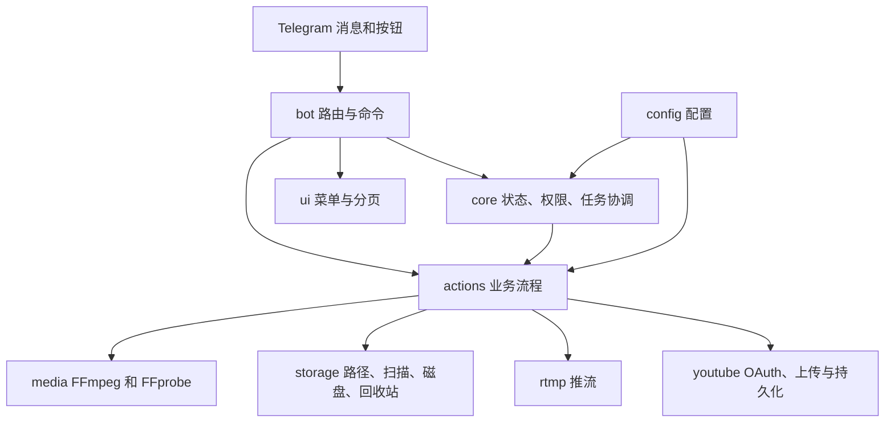

# Media Control Bot 架构

本页对应当前 `src/` 目录。入口在 [`main.rs`](src/main.rs)：加载配置、初始化日志与磁盘监控，创建共享状态和 Telegram 路由，并处理停止信号。

## 模块关系

| 目录 | 职责 |
| --- | --- |
| `config/` | 从环境变量加载并校验设置。 |
| `bot/`、`ui/` | 命令、按钮回调、菜单与选择器。 |
| `core/` | 管理员鉴权、菜单快照、任务状态、取消与进度。 |
| `actions/` | 浏览、合并、转封装、推流、上传、删除的编排。 |
| `media/`、`rtmp/` | FFprobe/FFmpeg 执行、合并策略及推流进度。 |
| `youtube/` | OAuth 凭据、HTTP 可恢复上传和可选队列持久化。 |
| `storage/` | 路径边界、目录扫描、临时文件、回收站和磁盘采样。 |
| `errors/`、`utils/` | 错误类型、格式化、时间与日志脱敏。 |

## 状态和文件边界

- `PathGuard` 通过规范化路径约束 `BASE_DIR`。目录不可达或路径越界时拒绝文件操作。
- 文件选择保留点击顺序；`MenuSnapshot` 记录菜单对应的目录内容，回调会检查旧列表是否已变化。
- 媒体任务通过协调器限制独占操作；YouTube 上传另设并发信号量与排队上限。`/stop` 和停止信号会向运行及排队任务发送取消。
- 合并与转封装使用同盘临时文件，经 FFprobe 校验后发布。删除保存待确认文件身份，二次确认后移入回收站；恢复时检查目标位置。
- `DiskMonitor` 检查 `STORAGE_MOUNT_POINT` 的挂载信息和容量，并保存告警状态以跨重启去重。

## 外部进程与服务

FFmpeg 和 FFprobe 作为子进程运行；处理流程主要使用 `-c copy`，即容器重封装，不执行重新编码。RTMP 仍由 FFmpeg 建立网络连接。YouTube 上传走 OAuth2 与 HTTP 分块会话，使用 `308 Range` 核实已接收偏移。Telegram 通知通过 Teloxide 发送。

配置中的 Token、RTMP 密钥及上传会话地址具有敏感性。`config/` 的 `Debug` 输出与 `utils/redact.rs` 的日志层负责脱敏；部署时仍需保护 `.env`、凭据及状态文件的文件权限。

## 修改入口

新增 Telegram 命令先检查 `bot/router.rs`、`bot/commands.rs` 与管理员鉴权；新增文件操作应复用 `storage/path.rs` 的边界检查和现有任务协调机制。改变媒体处理策略时，同时检查临时文件清理、输出校验与取消行为。完整操作参数见[使用指南](使用指南.md)。
